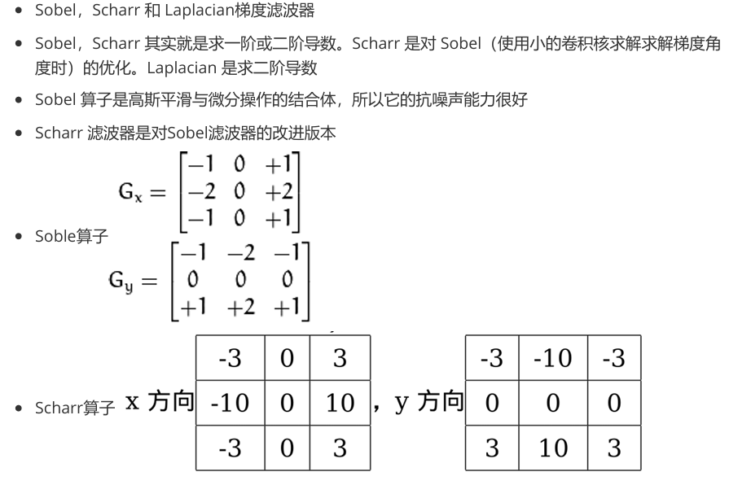
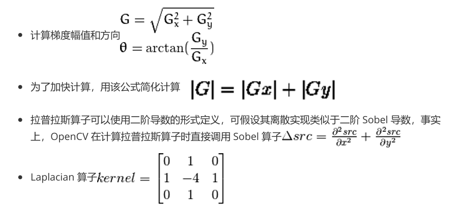
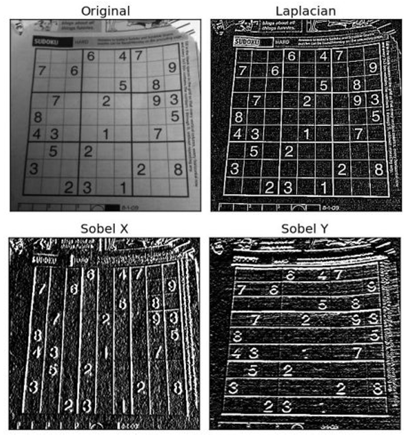

## 图像滤波

### 滤波的概念
- 滤波过程就是把不需要的信号频率去掉的过程
- 滤波操作一般用卷积操作来实现，卷积核一般称为滤波器
- 滤波分：低通滤波，高通滤波，中通滤波，阻带滤波
- 低通滤波也叫平滑滤波，可以使图像变模糊，主要用于去噪
- 高通滤波一般用于获取图像边缘、轮廓或梯度
- 中通滤波一般用于获取已知频率范围内的信号
- 阻带滤波一般用于去掉已知频率范围内的信号
- 滤波分析一般有时域分析和频域分析
- 时域分析是直接对信号本身进行分析
- 频域分析师对型号的变化快慢进行分析
### 卷积操作
```python
kernel = np.array([[1, 1, 0], [1, 0, -1], [0, -1, -1]], np.float32)  # 定义一个核
dst = cv2.filter2D(src, -1, kernel=kernel)
```
### 平滑操作
- 均值滤波
```python
dst = cv2.blur(src, (5,5))
```
- 高斯滤波
```python
dst = cv2.GaussianBlur(src, (5, 5), 0)
```
- 中值滤波
```python
dst = cv2.medianBlur(src, 5)
```
双边滤波
```python
dst = cv2.bilateralFilter(src,9,75,75)
```

### 锐化操作
- Laplacian锐化
```python
 kernel = np.array([[0, -1, 0], [-1, 5, -1], [0, -1, 0]], np.float32) #定义一个核
dst = cv2.filter2D(src, -1, kernel=kernel)
```
- USM锐化
```python
 dst = cv2.GaussianBlur(src, (5, 5), 0)
 dst = cv2.addWeighted(src, 2, dst, -1, 0)
```

### 梯度操作




```python
import cv2
from matplotlib import pyplot as plt

img = cv2.imread('6.jpg', 0)
laplacian = cv2.Laplacian(img, cv2.CV_64F)
sobelx = cv2.Sobel(img, cv2.CV_64F, 1, 0, ksize=5)
sobely = cv2.Sobel(img, cv2.CV_64F, 0, 1, ksize=5)

plt.subplot(2, 2, 1), plt.imshow(img, cmap='gray')
plt.title('Original'), plt.xticks([]), plt.yticks([])
plt.subplot(2, 2, 2), plt.imshow(laplacian, cmap='gray')
plt.title('Laplacian'), plt.xticks([]), plt.yticks([])
plt.subplot(2, 2, 3), plt.imshow(sobelx, cmap='gray')
plt.title('Sobel X'), plt.xticks([]), plt.yticks([])
plt.subplot(2, 2, 4), plt.imshow(sobely, cmap='gray')
plt.title('Sobel Y'), plt.xticks([]), plt.yticks([])
plt.show()

```


### 傅里叶变换
